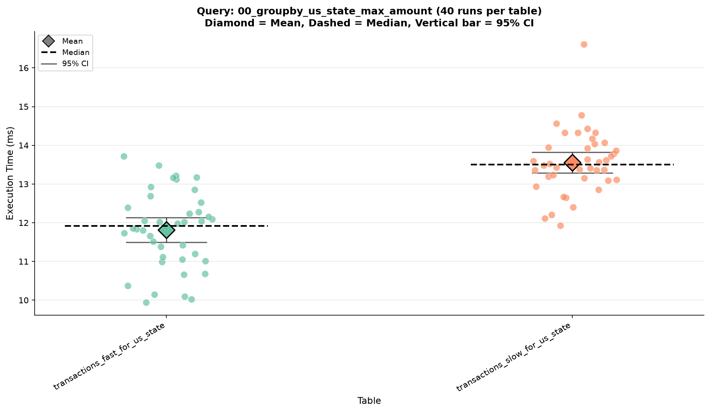
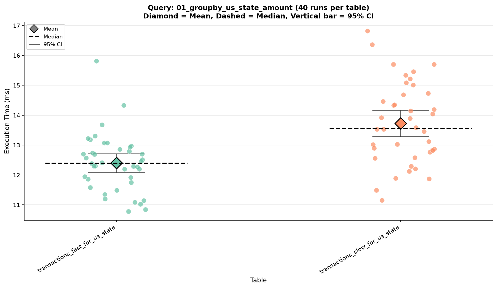
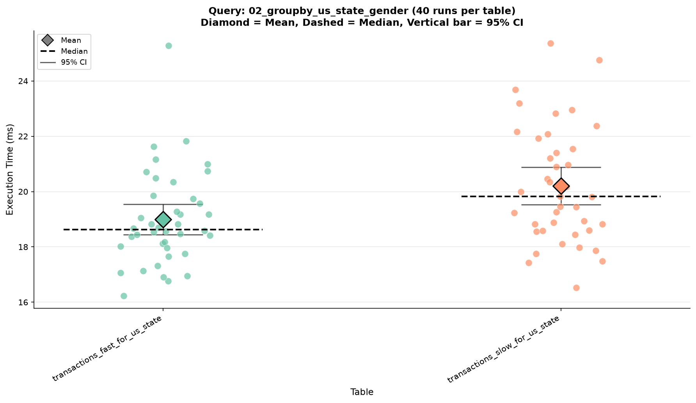
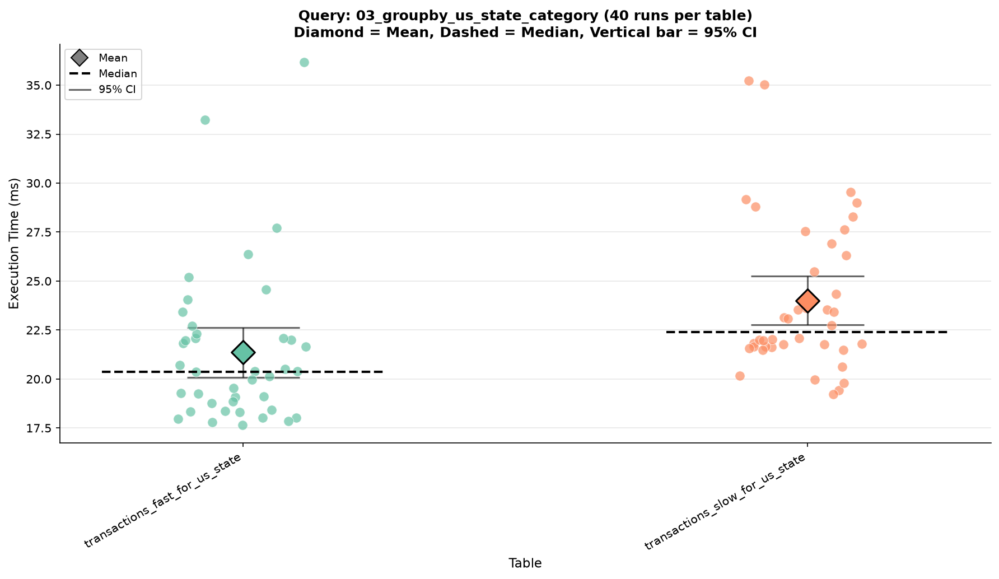
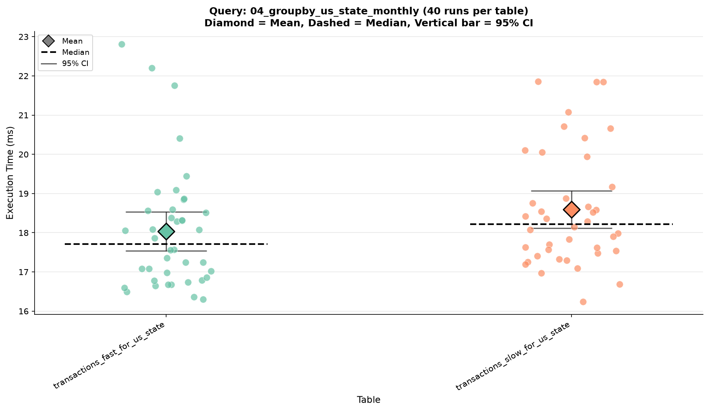

# ClickHouse Analytical Queries Benchmark Report

Generated: 2026-10-12 12:44:14
Repetitions per query: 40

---

## Table: `clients_transactions.transactions_fast_for_us_state`

```sql
CREATE TABLE clients_transactions.transactions_fast_for_us_state\n(\n    `transaction_id` String,\n    `transaction_time` DateTime,\n    `merch` LowCardinality(String),\n    `cat_id` LowCardinality(String),\n    `amount` Float64,\n    `name_1` String,\n    `name_2` String,\n    `gender` LowCardinality(String),\n    `street` String,\n    `one_city` LowCardinality(String),\n    `us_state` LowCardinality(String),\n    `post_code` UInt64,\n    `lat` Float64,\n    `lon` Float64,\n    `population_city` UInt64,\n    `jobs` LowCardinality(String),\n    `merchant_lat` Float64,\n    `merchant_lon` Float64\n)\nENGINE = MergeTree\nPARTITION BY toYYYYMM(transaction_time)\nORDER BY (us_state, transaction_time)\nSETTINGS index_granularity = 8192
```

### `00_groupby_us_state_max_amount`

- Runs: 40
- Mean: 11.81 ms
- Median: 11.92 ms
- P90: 13.16 ms
- P95: 13.22 ms
- Std Dev: 1.00 ms
- 95% CI: [11.50, 12.13] ms
- Min: 9.94 ms
- Max: 13.72 ms
- Rows Read (median): 100000
- Bytes Read (median): 912122

| us_state   |   max_amount |
|:-----------|-------------:|
| NY         |     14467.6  |
| CA         |     11422.8  |
| MI         |     10469.1  |
| OH         |      8296.8  |
| IN         |      8059.02 |

_Показаны первые 5 из 51 строк, полный результат — в `csvs/`._

### `01_groupby_us_state_amount`

- Runs: 40
- Mean: 12.40 ms
- Median: 12.39 ms
- P90: 13.23 ms
- P95: 13.71 ms
- Std Dev: 0.97 ms
- 95% CI: [12.09, 12.71] ms
- Min: 10.78 ms
- Max: 15.81 ms
- Rows Read (median): 100000
- Bytes Read (median): 912122

| us_state   |   total_amount |   avg_amount |   transaction_count |
|:-----------|---------------:|-------------:|--------------------:|
| TX         |         504502 |      69.6345 |                7245 |
| NY         |         464443 |      72.5806 |                6399 |
| PA         |         441013 |      71.6512 |                6155 |
| CA         |         319652 |      74.7374 |                4277 |
| OH         |         267323 |      74.8804 |                3570 |

_Показаны первые 5 из 51 строк, полный результат — в `csvs/`._

### `02_groupby_us_state_gender`

- Runs: 40
- Mean: 18.99 ms
- Median: 18.63 ms
- P90: 21.01 ms
- P95: 21.64 ms
- Std Dev: 1.72 ms
- 95% CI: [18.44, 19.54] ms
- Min: 16.23 ms
- Max: 25.27 ms
- Rows Read (median): 100000
- Bytes Read (median): 1012746

| us_state   | gender   |   transaction_count |   total_amount |   avg_amount |
|:-----------|:---------|--------------------:|---------------:|-------------:|
| AK         | M        |                 170 |        14604.7 |      85.9103 |
| AL         | F        |                1509 |       110919   |      73.5048 |
| AL         | M        |                1678 |        99671.1 |      59.3987 |
| AR         | F        |                1584 |       118716   |      74.9472 |
| AR         | M        |                 733 |        44948.3 |      61.321  |

_Показаны первые 5 из 98 строк, полный результат — в `csvs/`._

### `03_groupby_us_state_category`

- Runs: 40
- Mean: 21.36 ms
- Median: 20.38 ms
- P90: 25.33 ms
- P95: 27.99 ms
- Std Dev: 3.98 ms
- 95% CI: [20.09, 22.64] ms
- Min: 17.65 ms
- Max: 36.17 ms
- Rows Read (median): 100000
- Bytes Read (median): 1018482

| us_state   | cat_id        |   transaction_count |   total_amount |
|:-----------|:--------------|--------------------:|---------------:|
| AK         | gas_transport |                  24 |        1402.77 |
| AK         | home          |                  19 |        1307.07 |
| AK         | kids_pets     |                  17 |        1044.92 |
| AK         | grocery_pos   |                  15 |        1850.13 |
| AK         | shopping_net  |                  14 |         706.42 |

_Показаны первые 5 из 701 строк, полный результат — в `csvs/`._

### `04_groupby_us_state_monthly`

- Runs: 40
- Mean: 18.04 ms
- Median: 17.71 ms
- P90: 19.54 ms
- P95: 21.78 ms
- Std Dev: 1.56 ms
- 95% CI: [17.54, 18.54] ms
- Min: 16.30 ms
- Max: 22.81 ms
- Rows Read (median): 100000
- Bytes Read (median): 1312122

|   year_month | us_state   |   transaction_count |   total_amount |
|-------------:|:-----------|--------------------:|---------------:|
|       202003 | TX         |                 154 |        8873.99 |
|       202003 | PA         |                 149 |        9076.45 |
|       202003 | NY         |                 142 |        8056.3  |
|       202003 | CA         |                  92 |        5601.5  |
|       202003 | FL         |                  91 |        6371.98 |

_Показаны первые 5 из 751 строк, полный результат — в `csvs/`._

---

## Table: `clients_transactions.transactions_slow_for_us_state`

```sql
CREATE TABLE clients_transactions.transactions_slow_for_us_state\n(\n    `transaction_id` String,\n    `transaction_time` DateTime,\n    `merch` String,\n    `cat_id` String,\n    `amount` Float64,\n    `name_1` String,\n    `name_2` String,\n    `gender` String,\n    `street` String,\n    `one_city` String,\n    `us_state` String,\n    `post_code` UInt64,\n    `lat` Float64,\n    `lon` Float64,\n    `population_city` UInt64,\n    `jobs` String,\n    `merchant_lat` Float64,\n    `merchant_lon` Float64\n)\nENGINE = MergeTree\nPARTITION BY toYYYYMM(transaction_time)\nORDER BY (transaction_time, transaction_id)\nSETTINGS index_granularity = 8192
```

### `00_groupby_us_state_max_amount`

- Runs: 40
- Mean: 13.55 ms
- Median: 13.50 ms
- P90: 14.34 ms
- P95: 14.57 ms
- Std Dev: 0.83 ms
- 95% CI: [13.29, 13.82] ms
- Min: 11.93 ms
- Max: 16.61 ms
- Rows Read (median): 100000
- Bytes Read (median): 1216699

| us_state   |   max_amount |
|:-----------|-------------:|
| NY         |     14467.6  |
| CA         |     11422.8  |
| MI         |     10469.1  |
| OH         |      8296.8  |
| IN         |      8059.02 |

_Показаны первые 5 из 51 строк, полный результат — в `csvs/`._

### `01_groupby_us_state_amount`

- Runs: 40
- Mean: 13.73 ms
- Median: 13.56 ms
- P90: 15.48 ms
- P95: 15.73 ms
- Std Dev: 1.37 ms
- 95% CI: [13.29, 14.16] ms
- Min: 11.15 ms
- Max: 16.82 ms
- Rows Read (median): 100000
- Bytes Read (median): 1216699

| us_state   |   total_amount |   avg_amount |   transaction_count |
|:-----------|---------------:|-------------:|--------------------:|
| TX         |         504502 |      69.6345 |                7245 |
| NY         |         464443 |      72.5806 |                6399 |
| PA         |         441013 |      71.6512 |                6155 |
| CA         |         319652 |      74.7374 |                4277 |
| OH         |         267323 |      74.8804 |                3570 |

_Показаны первые 5 из 51 строк, полный результат — в `csvs/`._

### `02_groupby_us_state_gender`

- Runs: 40
- Mean: 20.20 ms
- Median: 19.82 ms
- P90: 22.97 ms
- P95: 23.74 ms
- Std Dev: 2.11 ms
- 95% CI: [19.53, 20.88] ms
- Min: 16.52 ms
- Max: 25.36 ms
- Rows Read (median): 100000
- Bytes Read (median): 1516699

| us_state   | gender   |   transaction_count |   total_amount |   avg_amount |
|:-----------|:---------|--------------------:|---------------:|-------------:|
| AK         | M        |                 170 |        14604.7 |      85.9103 |
| AL         | F        |                1509 |       110919   |      73.5048 |
| AL         | M        |                1678 |        99671.1 |      59.3987 |
| AR         | F        |                1584 |       118716   |      74.9472 |
| AR         | M        |                 733 |        44948.3 |      61.321  |

_Показаны первые 5 из 98 строк, полный результат — в `csvs/`._

### `03_groupby_us_state_category`

- Runs: 40
- Mean: 24.01 ms
- Median: 22.41 ms
- P90: 29.02 ms
- P95: 29.81 ms
- Std Dev: 3.90 ms
- 95% CI: [22.76, 25.25] ms
- Min: 19.22 ms
- Max: 35.24 ms
- Rows Read (median): 100000
- Bytes Read (median): 2565094

| us_state   | cat_id        |   transaction_count |   total_amount |
|:-----------|:--------------|--------------------:|---------------:|
| AK         | gas_transport |                  24 |        1402.77 |
| AK         | home          |                  19 |        1307.07 |
| AK         | kids_pets     |                  17 |        1044.92 |
| AK         | grocery_pos   |                  15 |        1850.13 |
| AK         | shopping_net  |                  14 |         706.42 |

_Показаны первые 5 из 701 строк, полный результат — в `csvs/`._

### `04_groupby_us_state_monthly`

- Runs: 40
- Mean: 18.59 ms
- Median: 18.22 ms
- P90: 20.75 ms
- P95: 21.85 ms
- Std Dev: 1.50 ms
- 95% CI: [18.11, 19.07] ms
- Min: 16.24 ms
- Max: 21.86 ms
- Rows Read (median): 100000
- Bytes Read (median): 1616699

|   year_month | us_state   |   transaction_count |   total_amount |
|-------------:|:-----------|--------------------:|---------------:|
|       202003 | TX         |                 154 |        8873.99 |
|       202003 | PA         |                 149 |        9076.45 |
|       202003 | NY         |                 142 |        8056.3  |
|       202003 | CA         |                  92 |        5601.5  |
|       202003 | FL         |                  91 |        6371.98 |

_Показаны первые 5 из 751 строк, полный результат — в `csvs/`._

---

## Summary (median ms)

| Table                          | 00_groupby_us_state_max_amount   | 01_groupby_us_state_amount   | 02_groupby_us_state_gender   | 03_groupby_us_state_category   | 04_groupby_us_state_monthly   |
|:-------------------------------|:---------------------------------|:-----------------------------|:-----------------------------|:-------------------------------|:------------------------------|
| transactions_fast_for_us_state | 11.92 [11.50, 12.13]             | 12.39 [12.09, 12.71]         | 18.63 [18.44, 19.54]         | 20.38 [20.09, 22.64]           | 17.71 [17.54, 18.54]          |
| transactions_slow_for_us_state | 13.50 [13.29, 13.82]             | 13.56 [13.29, 14.16]         | 19.82 [19.53, 20.88]         | 22.41 [22.76, 25.25]           | 18.22 [18.11, 19.07]          |

## Charts

### benchmark_query_00_groupby_us_state_max_amount.png



### benchmark_query_01_groupby_us_state_amount.png



### benchmark_query_02_groupby_us_state_gender.png



### benchmark_query_03_groupby_us_state_category.png



### benchmark_query_04_groupby_us_state_monthly.png



